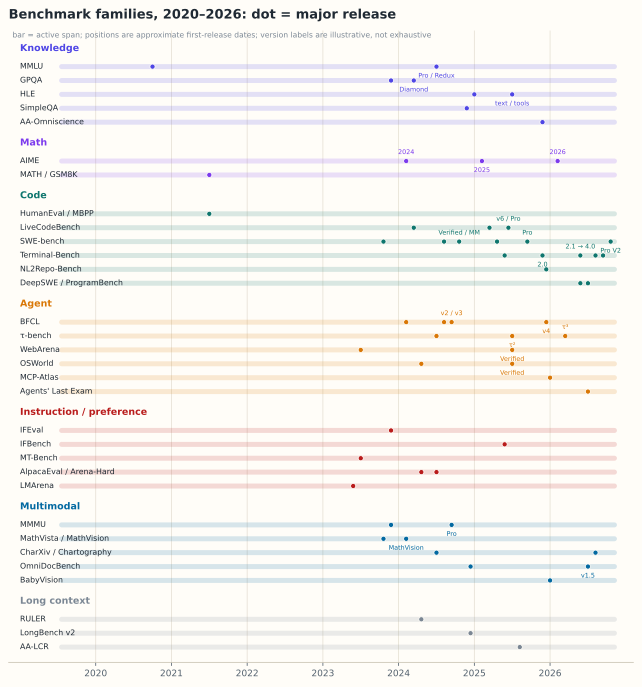

# M14 · 模型评测：从榜单到决策

> **这一模块回答**：模型发布表上那些名字——MMLU、GPQA、HLE、SWE-bench Pro、Terminal-Bench 2.1、IFBench、τ³、MMMU-Pro——**分别测什么、为什么有版本、分数该怎么读**？
>
> 它接在 [M11 大模型专题](../11-大模型专题/README.md) 与 [M13 推理服务](../13-推理服务/README.md) 之后：M11 讲模型内部，M13 讲模型怎么跑起来，M14 讲**怎么判断它到底行不行**。
>
> **性质**：专题手册 + 课程 14.1–14.7。手册给全景、版本谱系与读表法；七课分别深入数学、知识、代码、Agent、指令偏好、多模态与选型。

---

## 0. 三个现场

### 现场一：同一个基准，两个分数差 60

Qwen3.8-27B 的 Terminal-Bench 2.1 是 **73.0（Terminus）**；LFM3-1.7B 的同一个基准是 **12.92（OpenCode）**。

你可能会说“27B 比 1.7B 强，正常”。但先别急：

- 两者用的 **harness 不同**（Terminus vs OpenCode）；
- 同一张 Terminal-Bench 2.1 表里，Opus 4.6 用 Claude Code 是 70.1，用 Terminus 2 是 63.8；
- 89 道题的抽样误差约 ±10 分。

**问题**：这 60 分里，多少是模型，多少是脚手架，多少是噪声？

### 现场二：MMLU 从发布表里消失了

2024 年 DeepSeek-V3 的卡片：MMLU、MMLU-Pro、MMLU-Redux 全在。
2026 年 Qwen3.8-27B 的卡片：**知识栏一个 MMLU 都没有**，只剩 GPQA Diamond 和 HLE。

不是模型不考知识，而是 MMLU 饱和了：前沿 88–90 分、题目公开多年、还大量进了训练集。**尺子量不出差距，就换尺子。**

**问题**：MMLU 的 90 分和 HLE 的 30 分，能换算吗？为什么 GPQA 还活着？

### 现场三：43.40 与 61.7，谁更强

LFM3 的 SWE-bench Verified 是 **43.40**；Qwen3.8 的 SWE-bench Pro 是 **61.7**。

直觉会说“Qwen 强 18 分”。但这是两道不同的考试：

- Verified 是 500 道“确认可解”的题；
- Pro 是 1,865 道更难、含私有代码的题；
- 同一个模型从 Verified 换到 Pro，掉 20–40 分是常态。

**问题**：一张发布表里，哪些数字可以横向比，哪些只能纵向看？

---

## 1. 评测到底是什么

一个 benchmark 不是“一堆题”，而是五件套：

| 组件 | 回答什么 | 例子 |
| --- | --- | --- |
| 任务集 | 考什么、多少题 | SWE-bench Verified 500 题 |
| 环境 | 在哪里做、能不能上网 | Docker、浏览器、模拟数据库 |
| 脚手架（harness） | 谁来做、多少步、怎么提交 | OpenCode、Claude Code、Terminus |
| 判分器（grader） | 怎么算对 | 单元测试、最终状态、LLM judge |
| 报告口径 | 报哪个数、几次平均 | pass@1、avg@3、pass^4 |

**发布表通常只写第 1 项和第 5 项，把第 2–4 项塞进脚注。** 脚注才是复现的关键。

> 详细展开见 [14.1 评测的数学](01-评测的数学.md)。

---

## 2. 分类地图

```mermaid
flowchart TD
    A[模型评测] --> B[知识与推理]
    A --> C[数学]
    A --> D[代码与软件工程]
    A --> E[Agent 与工具]
    A --> F[指令遵循与偏好]
    A --> G[多模态]
    A --> H[长上下文]
    A --> I[综合指数与榜单]

    B --> B1[MMLU / MMLU-Pro / MMLU-Redux]
    B --> B2[GPQA Diamond]
    B --> B3[HLE / SuperGPQA]
    B --> B4[SimpleQA / AA-Omniscience]

    C --> C1[AIME 2024–2026]
    C --> C2[MATH-500 / GSM8K]
    C --> C3[FrontierMath]

    D --> D1[HumanEval / MBPP]
    D --> D2[LiveCodeBench v6 / Pro]
    D --> D3[SWE-bench 家族 / DeepSWE]
    D --> D4[Terminal-Bench / NL2Repo / ProgramBench]

    E --> E1[BFCL V4 / ToolSandbox / MCP-Atlas]
    E --> E2[τ³ / WebArena / OSWorld / AndroidWorld]
    E --> E3[Claw-Eval / ALE / APEX / JobBench]

    F --> F1[IFEval / IFBench / IFStruct / Multi-IF]
    F --> F2[MT-Bench / AlpacaEval / Arena-Hard / LMArena]

    G --> G1[MMMU / MMMU-Pro]
    G --> G2[MathVista / MathVision / CharXiv]
    G --> G3[BabyVision / ZeroBench / OmniDocBench]

    H --> H1[NIAH / RULER]
    H --> H2[LongBench v2 / MRCR / AA-LCR]

    I --> I1[AA Intelligence Index]
    I --> I2[LMArena / Open LLM Leaderboard]
```

### 八类能力，一张表

| 大类 | 核心问题 | 代表基准 | 什么时候看 |
| --- | --- | --- | --- |
| 知识与推理 | 知道不知道、能不能推 | MMLU、GPQA、HLE | 通用助手、专业问答 |
| 数学 | 能不能做竞赛/研究级数学 | AIME、MATH-500、FrontierMath | 数学、科学计算 |
| 代码与软件工程 | 能不能写、改、交付代码 | LiveCodeBench、SWE-bench、Terminal-Bench | 编码助手、Agent |
| Agent 与工具 | 能不能用工具把事做完 | BFCL、τ³、OSWorld、MCP-Atlas | 工具调用、自动化 |
| 指令遵循与偏好 | 听不听话、人喜不喜欢 | IFEval、IFBench、Arena-Hard | 结构化输出、对话产品 |
| 多模态 | 看不看得懂、能不能操作 | MMMU、CharXiv、OmniDocBench | 文档、图表、UI |
| 长上下文 | 装下之后能不能用 | RULER、LongBench v2、AA-LCR | 长文档、代码库 |
| 综合指数 | 加权平均 | AA Index、LMArena | 初筛、看趋势 |

---

## 3. 七课在讲什么

| 课 | 主题 | 你会得到 |
| --- | --- | --- |
| [14.1](01-评测的数学.md) | 分数、误差与可比性 | CI、pass@k、pass^k、Elo，判断“差距是不是噪声” |
| [14.2](02-知识与推理.md) | 从 MMLU 到 HLE | 知识/推理/事实性三条线，饱和与污染 |
| [14.3](03-代码与软件工程.md) | 从 HumanEval 到 Terminal-Bench | 四赛道、SWE-bench 家族、harness |
| [14.4](04-Agent与工具.md) | 从函数调用到长程工作 | 工具/会话/环境/企业/职业五级台阶 |
| [14.5](05-指令遵循与人类偏好.md) | IFEval、IFBench 与 Arena | 可验证约束 vs 主观偏好、judge 偏差 |
| [14.6](06-多模态与长上下文.md) | 从 MMMU 到 AA-LCR | 感知/图表/文档/行动，claimed vs effective |
| [14.7](07-读表与选型.md) | 把榜单变成决策 | 七问、版本速查、成本/成功任务、自测 |

## 3.1 分次阅读建议

<!-- reading-minutes: docs=340 extra=0 total=340 -->

> **预计阅读时间（含练习）**：340 分钟（各篇 `minutes` 之和；`minutes` 已含练习）
>
> 建议分 2 次完成：
>
> - **第 1 次（205 分钟）**：阅读 14.1–14.4（评测数学、知识/推理、代码、Agent/工具），建立「分数有误差」「benchmark 会饱和」「Agent 评测更接近真实工作」的核心判断。
> - **第 2 次（135 分钟）**：阅读 14.5–14.7（指令遵循、多模态/长上下文、读表选型），把榜单变成可落地的选型决策；配合本手册 §4–§11（版本谱系、读表七问、常见误读）一起读。

## 4. 版本命名的五种套路

看到一个新名字，先判断它属于哪一种：

| 套路 | 做法 | 例子 | 能不能和旧版比 |
| --- | --- | --- | --- |
| 扩容 | 加题、加语言、加领域 | SWE-bench Multilingual、MMLU-ProX | 不能 |
| 加难 | 换更难的数据/选项/约束 | MMLU-Pro、SWE-bench Pro、Terminal-Bench 3.0 | 不能 |
| 清洗 | 修标注、修测试、去泄漏 | Verified、Redux、Pro V2、2.1 | 不能，需重跑 |
| 改协议 | 换 harness/资源/判分 | Terminal-Bench 4.0、APEX 1.1 | 不能 |
| 自建 | 厂商内部题，不公开 | QwenSWEBench、CoWorkBench | 只能当自评 |

**一句话**：后缀不是“版本号”，而是“这次改了什么”。`Pro` 多半更难，`Verified` 多半更干净，`V2` 多半是修 bug，`2.1/4.0` 要看官方语义化规则。

---

## 5. 版本谱系总表

下面这张表是本模块的“字典”。读发布表时先在这里定位家族，再看版本。

| 家族 | 测什么 | 版本线 | 关键差异 | 读法 |
| --- | --- | --- | --- | --- |
| MMLU | 学科知识覆盖 | 2020 原版 → 2024 Pro → 2024 Redux | Pro 十选项 + CoT；Redux 人工质检 | 已饱和；看细分科目 |
| GPQA | 博士级专家推理 | 2023 原版 → Diamond（198 题） | Diamond 更硬 | 题少、方差大 |
| HLE | 前沿专家题 | 2025 原版 → text-only / tools 子集 | 规则差异大 | 必须同设置 |
| SuperGPQA | 大规模学科推理 | 2025 | 285 学科 | 覆盖广、区分度中等 |
| AIME | 竞赛数学 | 2024 / 2025 / 2026 | 每年换题 | 污染 + 题少；看 avg@n |
| MATH-500 / GSM8K | 中学/竞赛数学 | 2021–2024 | 已饱和 | 只适合小模型/回归 |
| SimpleQA | 短事实可靠性 | 2024 | 4,326 题 | 看幻觉与拒答 |
| AA-Omniscience | 跨域知识可靠性 | 2025 | 准确率 − 幻觉惩罚 | 可为负 |
| HumanEval / MBPP | 函数级代码 | 2021 | 164 / 374 题 | 已饱和、易污染 |
| LiveCodeBench | 竞赛代码 | v1–v6；Pro 2025 | 时间窗滚动、抗污染 | 看版本与题窗 |
| SciCode | 科学计算代码 | 2024 | 80 主问题 | 看子问题通过率 |
| SWE-bench | 真实 issue 修复 | 原版 → Verified → Multimodal → Multilingual → Pro → Pro V2 | 难度/语言/防作弊 | 家族内也不可混 |
| DeepSWE | 原创长程工程 | 2026 | 113 题、手写 verifier | 小样本、高信号 |
| Terminal-Bench | 终端长程任务 | 1.0 → 2.0 → 2.1 → 3.0 → 4.0 | 语义化版本 | major 变必须重跑 |
| NL2Repo-Bench | 从规格建仓库 | 2025 | 104 题、上游 pytest | 看 pass rate |
| ProgramBench | 从二进制重建程序 | 2026 | 200 题、24.8 万测试 | 看 resolved |
| BFCL | 函数调用 | v1 → v2 → v3 → v4 | 单轮→多轮→Agentic | overall 是子类平均 |
| ToolSandbox | 有状态工具对话 | 2024 | 里程碑 + canary | 看状态跟踪 |
| MCP-Atlas | 真实 MCP 服务器 | 2026 | 36 服务器、220 工具 | 看 claim-level |
| τ-bench | 会话式工具任务 | τ → τ² → τ³ | 域/知识/语音 | 看子域与 pass^k |
| WebArena | 网页长程任务 | 原版 → Verified | 清洗/判分 | 看 scaffold |
| OSWorld | 桌面操作 | 原版 → Verified | 清洗/判分 | 看版本 |
| AndroidWorld | 手机操作 | 2024 | 116 题、20 App | 看模拟器设置 |
| BrowseComp / Plus | 深度浏览 | 2025 → Plus | 固定语料 | 看检索设置 |
| Claw-Eval / Live | 工作流 Agent | 2026 | 可刷新信号 + 快照 | 看 release |
| APEX-Agents | 专业工作 | 1.0 → 1.1 | 修 scattergunning | 看 pass@1 / pass^4 |
| Agents' Last Exam | 55 职业长程 | 2026 → ALE-CLI | 全量 vs 终端子集 | 看子集 |
| IFEval | 可验证指令 | 2023 | 25 类指令 | 已饱和 |
| IFBench | 域外约束 | 2025 | 58 个新约束 | 看与 IFEval 的 gap |
| IFStruct / Multi-IF | 结构化 / 多语言多轮 | 2024–2025 | 格式与语言 | 看场景匹配 |
| MT-Bench | 多轮对话质量 | 2023 | 80 题、GPT-4 judge | 已被成对比较取代 |
| AlpacaEval 2.0 | 成对偏好 | 2024 | 长度控制 | 看 LC win rate |
| Arena-Hard | 硬题偏好 | 2024 → v2 | 500 题、GPT-4 judge | 看基线与版本 |
| LMArena | 真人偏好 | 持续 | Elo/BT、风格控制 | 看对手池 |
| MMMU | 大学多模态 | 2023 → Pro 2024 | 十选项/纯视觉 | 2026 已少报 |
| MathVista / MathVision | 视觉数学 | 2023 / 2024 | 更真实 | 看 CI 开关 |
| CharXiv | 真实论文图表 | 2024 | 图表推理 | 看 RQ 子集 |
| Chartography | 职业图表 | 2026 | 100 题、专业格式 | 难度更高 |
| BabyVision | 语言外视觉 | 2026 | 388 题、22 子类 | 看 CI 开关 |
| ZeroBench | 极难视觉 | 2025 | 100 题 + 子问题 | 看 with tools |
| OmniDocBench | 文档解析 | 2024 → 1.5 | 版式/指标 | 看指标 |
| RULER | 有效上下文 | 2024 | 13 类合成任务 | 看长度曲线 |
| LongBench v2 | 真实长文 | 2024 | 503 题、8k–2M 词 | 看任务类型 |
| AA-LCR | 长文推理 | 2025 | 约 100k token | 看文档类型 |
| AA Index | 综合指数 | v1–v5 | 权重会变 | 只看趋势 |

> **表的使用方式**：先在“家族”列找到名字，再看“版本线”确认你读到的是哪一代，最后用“读法”判断能不能横向比。**任何跨家族、跨版本的分数，默认不可比。**

---

## 6. 三年发布表的变化

把几张真实卡片的“评测栏”抽出来，能看到一条清晰的迁移：

| 年份 | 代表卡片 | 知识 | 代码 | Agent | 多模态 |
| --- | --- | --- | --- | --- | --- |
| 2024 | DeepSeek-V3 | MMLU、MMLU-Pro、Redux、GPQA、DROP、BBH | HumanEval、MBPP、LiveCodeBench | — | — |
| 2025 | Kimi-K2 | MMLU、MMLU-Pro、GPQA、SimpleQA | SWE-bench Verified/Multilingual、LCB v6 | — | — |
| 2026 | Qwen3.8-27B | GPQA、HLE | SWE-bench Pro、DeepSWE、NL2Repo、TB 2.1 | OSWorld、WebArena、AndroidWorld | MathVision、CharXiv、OmniDocBench |
| 2026 | LFM3-1.7B | GPQA、HLE、AA-Omniscience | SWE-bench Verified、LCB v6/Pro、TB 2.1 | BFCL、τ³、MCP-Atlas、Claw-Eval | — |
| 2026 | DeepSeek-V4.1 | HLE | DeepSWE、ProgramBench、NL2Repo、TB 4.0 | ALE、AutomationBench、APEX | Chartography、BabyVision、ZeroBench |

三个趋势：

1. **从“知识考试”转向“工作样本”**：MMLU → SWE-bench → Terminal-Bench → ALE。
2. **从“单模型”转向“模型 × harness”**：表头开始写 `(Terminus)`、`(OpenCode)`、`(Claude Code)`。
3. **从“准确率”转向“可靠性 + 成本”**：pass^k、avg@n、cost per task 出现得越来越频繁。

> 图里的点只标“首次发布/关键改版”，不标每一次小修；横条表示这个家族到 2026 年仍在被使用。**看时间线的好处是：你会先问“这把尺子是哪一年造的”，再问“分数是多少”。**

---

## 7. 读表七问

拿到任何一张发布表，按顺序问：

1. **能力**：这张表想证明什么？
2. **题集**：多少题、公开吗、和我的任务像吗？
3. **harness**：谁在动手？
4. **预算**：步数、超时、token、重试？
5. **判分**：测试、状态、rubric 还是 judge？
6. **版本**：哪一代？
7. **基线**：对手是谁、有没有重跑？

### 三个看不见的变量

| 变量 | 影响 | 例子 |
| --- | --- | --- |
| harness | 同一模型差 0.2–12 分 | Claude Code vs Terminus |
| 采样 | 温度/top_p/最大输出 | 代码题温度高 → 方差大 |
| judge | 换模型换分数 | HLE 由 GPT-4o 判 |

**这三个变量不写在分数旁，但决定了分数。**

---

## 8. 十条常见误读

1. **把不同 benchmark 放一张表排名。** Verified 43 与 Pro 61 不可比。
2. **把不同版本当同一考试。** TB 2.1 与 4.0 不可比。
3. **忽略 harness。** 同模型换脚手架能差 10 分。
4. **把 pass@k 当产品成功率。** 用户只调用一次。
5. **把 MMLU 当智力。** 它考覆盖与记忆，且已饱和。
6. **把 HLE 低分当模型差。** 题是给前沿专家出的。
7. **把 with CI 与 without CI 混比。** 差 5–20 分。
8. **把 claimed context 当 effective context。** 看 RULER 曲线。
9. **把 in-house 分数当公开证据。** 无法复现。
10. **把榜单第一当“最适合”。** 权重是别人定的。

---

## 9. 组合评测

一个负责任的模型评估，至少覆盖五个维度：

| 维度 | 建议基准 | 题量 | 备注 |
| --- | --- | --- | --- |
| 通用知识/推理 | GPQA Diamond + HLE | 198 + 子集 | 注意 tools 设置 |
| 代码 | LiveCodeBench v6 + SWE-bench 子集 | 100–300 | 固定 harness |
| Agent | BFCL + τ³ 或 OSWorld 子集 | 50–100 | 看 pass^k |
| 指令遵循 | IFBench + 自建模板 | 100+ | 联合约束 |
| 长上下文/多模态 | RULER + 你的文档 | 50–100 | 看有效长度 |

**最小可行方案**：50–200 道真实题，双人标注，固定 harness，跑 3 次，报“均值 + CI + 成本 + p95 延迟”。

---

## 10. 术语表

| 术语 | 含义 |
| --- | --- |
| pass@1 | 一次采样成功的比例 |
| pass@k | $k$ 次采样至少一次成功 |
| pass^k | $k$ 次采样全部成功 |
| avg@n | $n$ 次平均 |
| CI | 置信区间 |
| harness / scaffold | 替模型动手的脚手架 |
| grader | 判分器 |
| rubric | 按要点打分的评分表 |
| contamination | 题目进入训练语料 |
| saturation | 分数接近上限、失去区分度 |
| reward hacking | 钻评测空子拿分 |
| claimed / effective context | 声称 / 有效上下文 |
| Elo / Bradley–Terry | 由两两胜负拟合的相对能力 |

---

## 11. 自测

1. 同一个 Terminal-Bench 2.1，Qwen 73.0、LFM3 12.92，差 60 分。列出至少四个造成差异的因素。
2. 为什么 2026 年的前沿卡不再报 MMLU？举两个理由。
3. SWE-bench Verified 与 Pro 的核心差别是什么？为什么不能直接比？
4. pass@1=50%、$n=8,c=4$ 时，pass^2 是多少？说明它衡量什么。
5. IFEval 96、IFBench 73，说明什么？应该补看什么？
6. “MMMU-Pro 90 分”与“Chartography 45 分”矛盾吗？为什么？
7. 厂商说“支持 1M 上下文”，你要看哪两个指标？
8. 为什么 Agent 评测要报 pass^k，而不只报 pass@1？
9. 一张发布表没写 harness，你该怎么处理？
10. 公开榜 A 第一、B 第二，但你的自建集 B 更好。你选谁？为什么？

自测答案

1. 模型规模/能力、harness（Terminus vs OpenCode）、采样与步数预算、题目子集、运行设置、噪声（89 题 ±10 分）。
2. 饱和（前沿 88–90，区分度低）；污染（题目公开多年、进入训练集）；此外还有“新题更能讲故事”的传播因素。
3. Verified 是 500 道人工确认可解的题；Pro 是 1,865 道更难、含私有/持份代码的题。题集、难度、判分环境都不同。
4. $\binom{4}{2}/\binom{8}{2}=6/28\approx21.4\%$；衡量“两次都成功”的可靠性，而不是“至少一次”。
5. 说明模型对“见过的约束”很熟、对“没见过的约束”泛化不足；应补看 IFStruct、Multi-IF 和自建模板。
6. 不矛盾。MMMU-Pro 是大学考试题、语言先验可帮忙；Chartography 是职业图表、要求读稀疏坐标轴/3D/领域约定，难度更高。
7. RULER（有效上下文曲线）与 AA-LCR/LongBench v2（真实长文推理）；还要看任务类型与设置。
8. 生产要的是“每次都成”，不是“多试几次能成”；pass^k 直接度量稳定性与状态污染。
9. 默认不可比；去官方仓库/论文找评测协议，或自己在同一 harness 下重跑。
10. 选自建集更好的 B，但要检查：自建集是否覆盖高频/长尾、是否双人标注、CI 是否重叠、成本是否可接受；公开榜只作初筛。

---

## 12. 文件与延伸阅读

- 课程：[14.1](01-评测的数学.md) · [14.2](02-知识与推理.md) · [14.3](03-代码与软件工程.md) · [14.4](04-Agent与工具.md) · [14.5](05-指令遵循与人类偏好.md) · [14.6](06-多模态与长上下文.md) · [14.7](07-读表与选型.md)
- 习题：[m14-习题](../exercises/m14-习题.md) ｜ 答案：[m14-答案](../exercises/m14-答案.md)
- 题库：[quizbank/m14.yaml](https://github.com/kingfs/Linear-Algebra-to-LLM/blob/main/quizbank/m14.yaml)
- 相邻模块：[M11 大模型专题](../11-大模型专题/README.md)、[M13 推理服务](../13-推理服务/README.md)
- 外部索引：[Terminal-Bench](https://www.tbench.ai/benchmarks)、[SWE-bench](https://www.swebench.com/)、[BFCL](https://gorilla.cs.berkeley.edu/leaderboard.html)、[τ-bench](https://taubench.com/)、[LMArena](https://lmarena.ai/)
