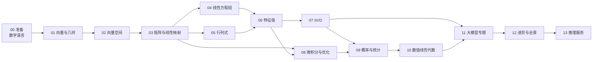

# 从线性代数到大模型

> 一门为「想真正读懂大模型」的人重写的课：从线性代数开始，一路讲到大模型底层。
> 不从行列式开始，而从「一句话怎么变成一串数字、又怎么变成另一串数字」开始。

**仓库**：[`kingfs/Linear-Algebra-to-LLM`](https://github.com/kingfs/Linear-Algebra-to-LLM) ｜ **在线站点**：<https://kingfs.github.io/Linear-Algebra-to-LLM/>

**一句话简介**：用几何直觉 + 场景化例子，把线性代数从「考试公式」还原成「描述高维世界的语言」，并一路讲到 Attention、LoRA、KV Cache、量化背后的矩阵运算。

**规模**：14 个模块 · 81 篇概念文档 · 13 组习题 · 12 个可运行 lab · 2 份速查表 · 358 道可判分题 · 56 张图。

---

## Web 学习平台（新增）

除了读 Markdown，现在还可以在浏览器里学习、做题、翻卡和看生成图：

- 阅读：81 篇概念页，带目录、上下篇、KaTeX 公式、Mermaid 图、Python 生成的 SVG 图，以及可跳转的「参考文献与致谢」。
- 练习：358 道单选/多选/判断/数值题，即时判分、解析回链原文、错题本。
- 复习：「一页速记」自动转成 479 张知识卡，按间隔重复排期。
- 进度：阅读、正确率、薄弱概念、到期卡片，全部存在本机 IndexedDB，无需登录。

```bash
cd web
pnpm install
pnpm dev --port 4321
# 打开 http://127.0.0.1:4321/
```

详细说明见 [`web/README.md`](web/README.md)，题库规范见 [`quizbank/README.md`](quizbank/README.md)，图脚本见 `figures/`，入口是 `figures/manifest.yaml`。

---

## 本地开发（go-task）

仓库根目录的 [`Taskfile.yml`](https://github.com/kingfs/Linear-Algebra-to-LLM/blob/main/Taskfile.yml) 把常用命令收成 `task`：

```bash
task doctor      # 检查 python/node/pnpm/uv/Chrome
task setup       # 安装 Web 与 Python 依赖
task dev         # 启动 http://127.0.0.1:4321/
task check       # 概念结构 / 文献 / 全仓链接
task check:web   # 构建后查站内链接、锚点与渲染
task e2e         # 13 项浏览器检查
```

完整命令、变量与排错见 [`docs/本地开发.md`](docs/本地开发.md)。

---

## 这门课为谁而写

- 你已经会用大模型（调 API、写 prompt），但看到 `QK^T / sqrt(d_k)`、`W_Q`、`rank`、`SVD` 时心里发虚。
- 你学过线性代数，但只记得「行列式展开」和「求逆」，不知道这些概念在模型里对应什么。
- 你想以后研究推理过程、模型内部表示、训练稳定性，需要一套**能支撑底层阅读**的数学地基。
- 你希望有人把「为什么这样定义」讲清楚，而不是甩给你一页定理。

**前置要求**：初中数学 + 一点点编程意识即可。我们不假设你记得任何线性代数。

---

## 你将获得什么

1. **一套完整的概念地图**：从向量、空间、矩阵、方程组，到特征值、SVD、二次型、数值稳定性，再到微积分/概率接口。
2. **每个概念的四个层次**：现实对应与直觉 → 定义动机（含反事实反例）→ 手算例子与场景闭环 → 大模型落点。
3. **可运行的实验**：`labs/` 里的 NumPy 代码，亲手验证「点积衡量相似度」「SVD 做低秩近似」「attention 的形状」。
4. **一套可复习的速查体系**：公式卡、符号表、术语中英对照、一页速记。
5. **可追溯的出处**：每篇文末列出 2–5 条原始论文或权威整理，正文中的人名、定理名可点击跳到对应文献。
6. **一条可持续的研究路线**：最后一章告诉你，线性代数之后该补什么，才能读懂 Transformer 推理；M13 再给你一张推理服务选型地图。

---

## 课程地图



| 模块 | 主题 | 核心问题 | 大模型落点 |
|---|---|---|---|
| [M00](00-准备/README.md) | 准备 | 数学符号怎么读？张量的「轴」是什么？ | 形状 `[B, T, D]` |
| [M01](01-向量与几何/README.md) | 向量与几何 | 如何用数字表示「方向」和「相似」？ | embedding、余弦相似度 |
| [M02](02-向量空间/README.md) | 向量空间 | 什么是维度、基、秩？为什么「无关」重要？ | 表示空间、低秩结构 |
| [M03](03-矩阵与线性映射/README.md) | 矩阵与线性映射 | 矩阵为什么是「函数」？乘法为什么那样定义？ | 线性层、权重矩阵 |
| [M04](04-线性方程组/README.md) | 线性方程组 | 解什么时候存在、唯一？无解怎么办？ | 最小二乘、微调 |
| [M05](05-行列式/README.md) | 行列式 | 行列式到底在量什么？ | 变量替换、归一化流 |
| [M06](06-特征值/README.md) | 特征值 | 变换中哪些方向「不变」？ | 稳定性、幂迭代 |
| [M07](07-SVD/README.md) | SVD | 任意矩阵能否拆成「旋转-拉伸-旋转」？ | LoRA、压缩、伪逆 |
| [M08](08-微积分与优化/README.md) | 微积分与优化 | 梯度、Jacobian、Hessian 如何连接？ | 反向传播、训练 |
| [M09](09-概率与统计/README.md) | 概率与统计 | 数据云的形状如何用矩阵描述？ | 协方差、PCA、采样 |
| [M10](10-数值线性代数/README.md) | 数值线性代数 | 为什么数学上可逆、计算机里会炸？ | 精度、显存、GEMM |
| [M11](11-大模型专题/README.md) | 大模型专题 | 把前面所有概念串成一次 forward | Attention、RoPE、量化 |
| [M12](12-进阶/README.md) | 进阶与全景 | 下一步读什么、研究什么？ | 推理研究路线 |
| [M13](13-推理服务/README.md) | 推理服务与运行时 | 模型如何变成可调用、可并发、省显存的服务？ | 引擎、量化、KV、调度、选型 |

详细到每一节的清单见 [`curriculum/syllabus.md`](curriculum/syllabus.md)，依赖关系与三种学习路线见 [`docs/学习地图.md`](docs/学习地图.md)。

---

## 三种学习路线

### 路线 A：四周速成（先能读懂模型代码）
`M00 → M01 → M02（2.1–2.6）→ M03 → M07（7.1–7.3）→ M11`

适合：马上要读 Transformer 实现、需要补形状与矩阵运算直觉的人。
代价：跳过行列式、Jordan、数值分析细节。

### 路线 B：十周完整（推荐）
`M00 → M01 → M02 → M03 → M04 → M05 → M06 → M07 → M08 → M09 → M10 → M11 → M12 → M13`

适合：希望建立完整地基、之后做推理/训练研究的人。
每周 6–8 小时，配合习题与 lab。

### 路线 C：研究者加餐
在路线 B 之上，重点加读：`6.4 谱定理`、`7.3 低秩近似`、`8.5 矩阵求导`、`9.3 PCA`、`10.2 条件数`、`11.3–11.8`、`12.2 随机矩阵`；M13 作为选读，建立推理服务选型直觉。

---

## 怎么用这个仓库

0. **先建立尺度感**：翻一遍 [`docs/概念-现实对应表.md`](docs/概念-现实对应表.md)，看每个概念在现实中对应什么、量级多大、类比在哪里失效。
1. **按模块读**：每个模块先读 `README.md`（导览 + 概念地图 + 自测），再按编号读概念文档。
2. **每篇都动手**：文档里的手算例子请遮住答案自己算一遍；`## 9. 练习` 做完再看折叠答案。
3. **跑实验**：`cd labs && python3 -m venv .venv && . .venv/bin/activate && pip install -r requirements.txt`，然后按 lab 编号运行。
4. **复习用速查**：`cheatsheets/` 里的公式卡与术语表。
5. **卡住时**：回到「概念网络」小节看前置；仍不懂就在该篇的练习区记录问题（本地笔记），不要跳过硬啃。

---

## 仓库结构

```
├── AGENTS.md          # agent/贡献者协作规范（写作模板、检查、提交）
├── PROGRESS.md        # 模块进度与任务队列
├── Taskfile.yml       # go-task 本地工作流
├── docs/              # 学习地图、符号表、概念-现实对应表、叙事增强规范、图示规划
├── curriculum/        # 完整大纲、周计划
├── 00-准备/ … 13-推理服务/ # 课程正文（每篇一个概念；M13 为专题手册）
├── exercises/         # 每模块习题 + 答案
├── labs/              # NumPy 实验
├── cheatsheets/       # 速查卡
└── scripts/check.py   # 质量门禁；check_refs.py 核对文献与锚点
```

---

## 阅读约定

- **符号**：向量 $\mathbf{x}$、矩阵 $A$、转置 $A^\top$、范数 $\|\mathbf{x}\|_2$。完整表见 [`docs/符号表.md`](docs/符号表.md)。
- **形状**：`[m, n]` 表示 $m$ 行 $n$ 列；大模型里 `[B, T, D]` = batch × 序列长度 × 隐藏维度。
- **索引**：数学从 1 开始，代码从 0 开始，文中会明确标注。
- **难度标记**：`核心`（必读）、`进阶`（研究需要）、`选学`（兴趣扩展）。

---

## 当前进度

课程已完整建成：14 个模块、81 篇概念文档、13 组习题、12 个 lab。全仓通过：

```bash
python3 scripts/check.py        # 81 篇概念文档：0 error / 0 warning
python3 scripts/check_refs.py    # 81 篇文献与页内锚点：0 error
python3 scripts/check_links.py  # 140 个 Markdown：0 断链
```

逐模块状态与变更记录见 [`PROGRESS.md`](PROGRESS.md)。

---

## 给协作者 / Agent

先读 [`AGENTS.md`](AGENTS.md)，再运行：

```bash
python3 scripts/check.py
python3 scripts/check_refs.py
python3 scripts/check_links.py
```

所有概念文档遵循统一模板与十二节结构（0–11，含「参考文献与致谢」）；新增内容必须通过三个检查后再提交。叙事增强（现场 / 现实对应 / 反事实 / 场景闭环）的细则见 [`docs/叙事增强规范.md`](docs/叙事增强规范.md)；哪些内容该配图、怎么新增一张图，见 [`docs/图示规划.md`](docs/图示规划.md)。

---

## 许可证

本项目（代码与课程文字）采用 [MIT License](https://github.com/kingfs/Linear-Algebra-to-LLM/blob/main/LICENSE) 发布：可以自由使用、修改、分发，保留版权与许可声明即可。
