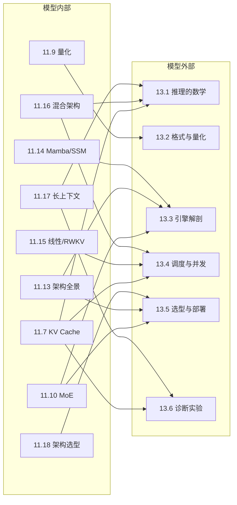

# M11 ↔ M13 交叉索引：从架构到服务

> **一句话**：M11 讲“模型内部怎么算”，M13 讲“模型外部怎么跑”；同一组公式在两边的名字不同，但账本是同一本。
>
> 入口：[M11 大模型专题](../11-大模型专题/README.md) ｜ [M13 推理服务与运行时](../13-推理服务/README.md)

## 0. 怎么用这一页

- 学 M11 的某个结构时，右边一列告诉你它在 M13 的哪一课变成“显存/带宽/调度”问题。
- 学 M13 的某个服务问题时，左边一列告诉你该回 M11 补哪块数学。
- 做项目时，从“现象”出发：先看 §4 的三条路径，再按表跳转。

## 1. 一张总图

## 2. M11 → M13：学完结构，去看它怎么变成账单

| M11 | M13 | 连接点 |
| --- | --- | --- |
| [11.4 Attention（下）](../11-大模型专题/04-Attention-下-softmax与多头.md) | [13.1 推理的数学](../13-推理服务/01-推理的数学.md)、[13.3 引擎解剖](../13-推理服务/03-引擎解剖.md) | $T^2$ 分数、KV、prefill/decode |
| [11.7 KV Cache](../11-大模型专题/07-KVCache.md) | [13.1](../13-推理服务/01-推理的数学.md)、[13.4](../13-推理服务/04-调度与并发.md)、[13.6](../13-推理服务/06-诊断实验.md) | KV 公式、PagedAttention、OOM/复读 |
| [11.9 量化](../11-大模型专题/09-量化.md) | [13.2 模型格式与量化](../13-推理服务/02-模型格式与量化.md) | GGUF/EXL2/NVFP4/FP8、bpw、KV 精度 |
| [11.10 MoE](../11-大模型专题/10-MoE路由.md) | [13.3](../13-推理服务/03-引擎解剖.md)、[13.5](../13-推理服务/05-选型与部署.md) | 专家缓存、总参数 vs 激活参数 |
| [11.13 架构全景](../11-大模型专题/13-架构全景.md) | [13.3](../13-推理服务/03-引擎解剖.md)、[13.5](../13-推理服务/05-选型与部署.md) | attention/SSM/线性/混合的推理代价 |
| [11.14 Mamba/SSM](../11-大模型专题/14-Mamba与SSM.md) | [13.3](../13-推理服务/03-引擎解剖.md)、[13.4](../13-推理服务/04-调度与并发.md) | 固定状态、无 KV、scan kernel |
| [11.15 RWKV/线性](../11-大模型专题/15-RWKV与线性注意力.md) | [13.4](../13-推理服务/04-调度与并发.md)、[13.5](../13-推理服务/05-选型与部署.md) | 常数状态、边缘部署 |
| [11.16 混合架构](../11-大模型专题/16-混合架构.md) | [13.1](../13-推理服务/01-推理的数学.md)、[13.4](../13-推理服务/04-调度与并发.md) | 只有 attention 层有 KV；SWA 截断 |
| [11.17 长上下文外推](../11-大模型专题/17-长上下文外推.md) | [13.1](../13-推理服务/01-推理的数学.md)、[13.6](../13-推理服务/06-诊断实验.md) | RoPE/YaRN/SWA、32k 复读 |
| [11.18 架构选型](../11-大模型专题/18-架构选型.md) | [13.5 选型与部署](../13-推理服务/05-选型与部署.md) | FLOPs/KV/质量/成本四本账 |

## 3. M13 → M11：遇到服务问题，回去补哪块数学

| M13 | M11 | 回看重点 |
| --- | --- | --- |
| [13.1 推理的数学](../13-推理服务/01-推理的数学.md) | [11.7](../11-大模型专题/07-KVCache.md)、[11.9](../11-大模型专题/09-量化.md)、[11.13](../11-大模型专题/13-架构全景.md)、[11.16](../11-大模型专题/16-混合架构.md) | 字节账单从哪来 |
| [13.2 模型格式与量化](../13-推理服务/02-模型格式与量化.md) | [11.9](../11-大模型专题/09-量化.md) | scale/group/误差、bpw |
| [13.3 引擎解剖](../13-推理服务/03-引擎解剖.md) | [11.4](../11-大模型专题/04-Attention-下-softmax与多头.md)、[11.7](../11-大模型专题/07-KVCache.md)、[11.13](../11-大模型专题/13-架构全景.md)、[11.14](../11-大模型专题/14-Mamba与SSM.md) | slot/scheduler/KV/状态 |
| [13.4 调度与并发](../13-推理服务/04-调度与并发.md) | [11.7](../11-大模型专题/07-KVCache.md)、[11.16](../11-大模型专题/16-混合架构.md)、[11.17](../11-大模型专题/17-长上下文外推.md) | KV 预算、SWA、长上下文 |
| [13.5 选型与部署](../13-推理服务/05-选型与部署.md) | [11.9](../11-大模型专题/09-量化.md)、[11.10](../11-大模型专题/10-MoE路由.md)、[11.18](../11-大模型专题/18-架构选型.md) | 量化/稀疏/架构账单 |
| [13.6 诊断实验](../13-推理服务/06-诊断实验.md) | [11.7](../11-大模型专题/07-KVCache.md)、[11.9](../11-大模型专题/09-量化.md)、[11.17](../11-大模型专题/17-长上下文外推.md) | 复读/OOM/质量回退 |

## 4. 三条学习路径

### 路径 A：自底向上（先结构，后服务）

`11.7 KV → 13.1 推理的数学 → 13.4 调度 → 13.6 诊断`

适合：想先弄懂“为什么长上下文贵”，再看服务怎么省。

### 路径 B：自顶向下（先现象，后结构）

`13.1 32k 复读 → 11.17 长上下文 → 11.16 混合架构 → 13.4 调度`

适合：手上已经有服务问题，需要回补数学。

### 路径 C：项目驱动（架构 → 服务）

`11.18 架构选型 → 13.2 格式 → 13.3 引擎 → 13.5 部署`

适合：要做一个“给定硬件/模型，选型 + 部署”的项目。

## 5. 一条主线：同一本账

- **KV**：$2LH_{kv}d_kTb$；M11 用它解释长上下文，M13 用它算并发/OOM。
- **FLOPs**：attention $O(T^2D)$；M11 用它比较架构，M13 用它分 prefill/decode。
- **量化**：M11 讲 scale/误差，M13 讲 GGUF/EXL2/NVFP4/FP8 KV。
- **MoE**：M11 讲路由/稀疏，M13 讲专家缓存/总参数 vs 激活参数。
- **状态**：M11 讲 SSM/线性/RWKV，M13 讲“没有 KV 但有权重/状态/带宽”。

## 6. 常见误区

1. **“学架构不用管服务”**  
   架构决定 KV/状态/计算曲线；不看服务，就不知道这些曲线在真实硬件上值多少钱。

2. **“学服务不用回数学”**  
   32k 复读、OOM、吞吐低，最后都要回到 KV/带宽/量化的公式。

3. **“M11 和 M13 是两门课”**  
   它们是同一门课的两端：M11 是“模型内部”，M13 是“模型外部”。

4. **“背结论就行”**  
   结论会随模型/硬件变；账本（公式）不会。

## 7. 下一步

- 读完 M11.13–11.18，去做 [M13.1–13.6](../13-推理服务/README.md) 的练习。
- 读完 M13.6，回 [11.18](../11-大模型专题/18-架构选型.md) 做一次“给定硬件选架构”的复盘。
- 想把两者连成项目：选一个模型，画它的 KV/状态曲线，再选一个引擎跑 32k/128k。

---

**交叉入口**：

- [M11 大模型专题](../11-大模型专题/README.md)
- [M13 推理服务与运行时](../13-推理服务/README.md)
- [M11.13 架构全景](../11-大模型专题/13-架构全景.md)
- [M13.1 推理的数学](../13-推理服务/01-推理的数学.md)
