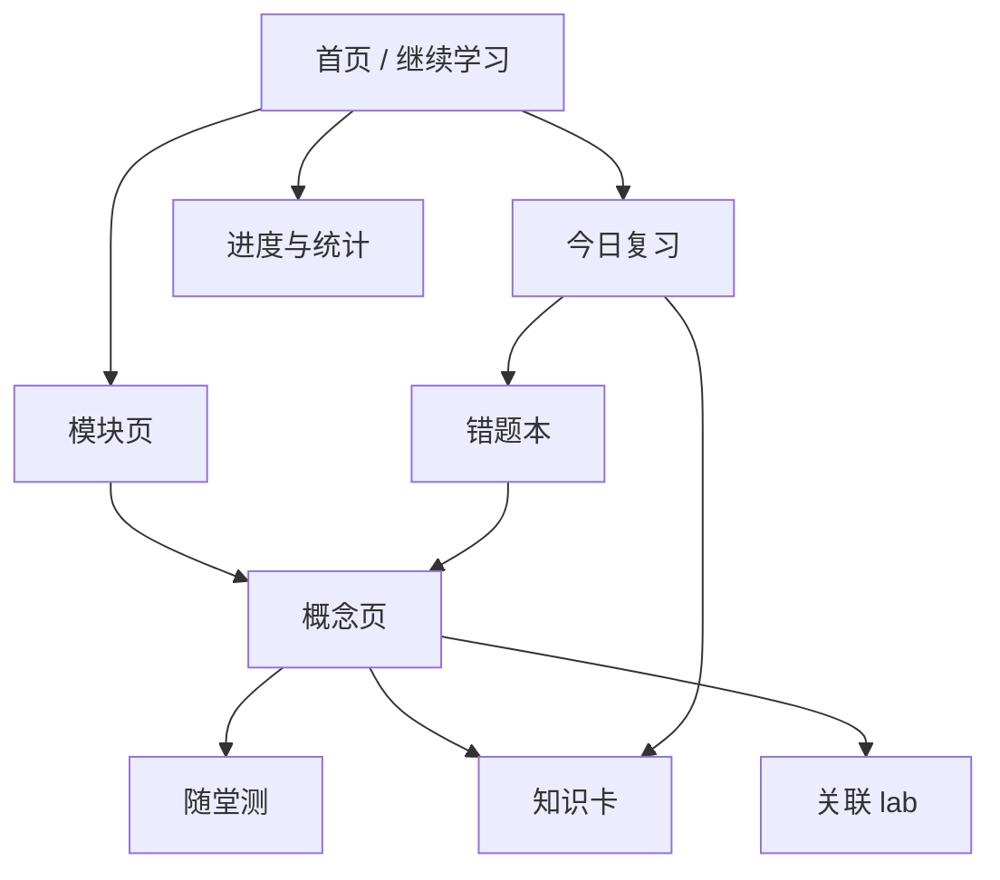
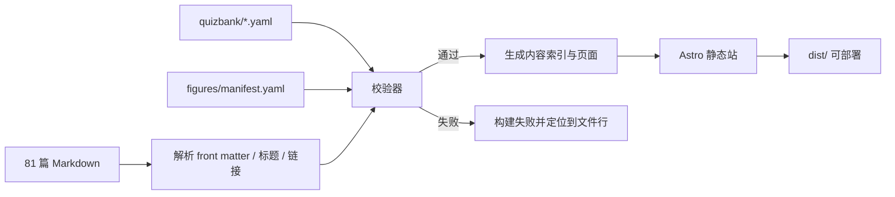

# Web 学习平台方案：从 Markdown 课程到可练习的学习产品

> 结论：**可行，而且这个仓库的内容结构非常适合做。**
> 真正的成本不在「把 Markdown 变成网页」，而在**题库审校**与**交互细节**；技术选型可以用成熟的静态站点方案，风险很低。

---

## 0. 先给结论

| 问题 | 判断 |
|---|---|
| 能不能做？ | 能。内容已有统一 front matter、固定 11 节、13 组习题、12 个 lab，天然适合结构化解析。 |
| 值不值得做？ | 值。阅读、练习、错题、可视化在同一个页面闭环，学习效率明显高于纯 Markdown。 |
| 最大的坑是什么？ | 自动生成题目的质量、内容双份维护、数学公式在移动端的排版。 |
| 推荐路线？ | **静态优先 + 本地优先**：Astro 静态站，题目/进度存本地；先做 4 个模块试点，再全量。 |
| 是否需要后端？ | MVP 不需要。账号、云同步、排行榜是第二阶段的可选项。 |

**一句话架构**：Markdown 仍是唯一内容源；构建时解析成结构化内容与题库；Web 只负责渲染、交互与记录学习状态。

---

## 1. 为什么这个仓库特别适合

普通课程仓库做 Web 化，最痛的是「内容没有结构，只能整页转 HTML」。这套课程恰好相反：

1. **每篇 11 节固定结构**：`## 0` 到 `## 10` 可以稳定映射为页面区块、目录、题目来源。
2. **front matter 完整**：`id / module / prereq / minutes / level / tags / llm_hooks` 可直接生成导航、先修图、难度标签。
3. **已有练习与答案**：`exercises/mNN-习题.md` 和 `mNN-答案.md` 可直接变成「练习模式」，不必从零出题。
4. **已有 lab**：12 个 NumPy 脚本可以变成「实验」页面，或把输出图预生成后嵌入。
5. **已有质量门禁**：`scripts/check.py` 与 `scripts/check_links.py` 可以在 Web 构建前复用，防止内容与页面脱节。
6. **概念独立成篇**：天然适合「知识卡 + 小测 + 间隔重复」，而不是只能按长文阅读。

---

## 2. 产品形态：三层，而不是一个「网页版 PDF」

### 2.1 阅读层

- 左侧模块树，右侧当前概念的目录（0–11 节）。
- 顶部：模块、难度、预计分钟、前置概念、上一篇/下一篇。
- 正文：KaTeX 数学、Mermaid 图、代码高亮、表格、折叠答案。
- 阅读进度：按小节记录，刷新不丢。
- 搜索：标题、标签、正文关键词；支持 `⌘K`。
- 「一页速记」固定在文末，可一键生成复习卡。

### 2.2 练习层

四种模式，共用同一套题目数据：

| 模式 | 内容 | 判分 |
|---|---|---|
| 随堂测 | 当前概念的 3–5 题 | 即时判分 + 解析 + 回链原文 |
| 知识卡 | 定义、公式、误区 | 翻卡自评，进入间隔重复队列 |
| 错题本 | 做错的题与关联概念 | 重做、查看解析、标记已掌握 |
| 模拟卷 | 跨模块抽题 | 计时、总分、按模块分析 |

题型建议先做四种：

1. **单选**：概念辨析、公式选择。
2. **多选**：性质判断、条件组合。
3. **判断**：直接来自每篇「常见误区」，把错误说法做成判断题。
4. **数值填空**：来自手算例子，支持误差范围与单位。

开放题（证明、解释）不自动判分，显示参考答案，让用户自评「会 / 半会 / 不会」，进入复习队列。

### 2.3 可视化层

分两类，不要混为一谈：

| 类型 | 实现 | 例子 |
|---|---|---|
| 解释型静态图 | Python 预生成 SVG/PNG | 投影分解、行列式面积、SVD 圆变椭圆、PCA 主轴、RoPE 旋转 |
| 探索型交互 | 浏览器 JS/SVG/Canvas | 拖动矩阵看网格变形、调 softmax 温度、算 KV Cache 显存 |

**原则**：需要「一看就懂」的图用 Python 预生成；需要「自己动手试」的用 JS 交互。不要在 MVP 阶段引入 Pyodide 在浏览器跑 Python，包体大、移动端慢，收益有限。

---

## 3. 页面与信息架构



### 3.1 核心页面

| 页面 | 作用 | 关键组件 |
|---|---|---|
| 首页 | 继续上次、今日复习、推荐下一步 | 进度环、到期卡数、最近概念 |
| 模块页 | 模块目标、概念地图、顺序 | Mermaid 依赖图、文档列表 |
| 概念页 | 主阅读界面 | 目录、正文、图、随堂测入口 |
| 练习页 | 做题与解析 | 题卡、选项、判分、原文回链 |
| 复习页 | 间隔重复 | 翻卡、四档评分、到期队列 |
| 进度页 | 掌握度与薄弱点 | 模块热力图、正确率、时间 |

### 3.2 导航规则

- 侧边栏：模块 → 概念，显示「已读 / 练习过 / 掌握」三种状态。
- 概念页底部：`上一篇 / 下一篇`，与模块 README 的顺序一致。
- 前置概念未读时给提示，但不强制阻断。
- 移动端：底部 Tab（学习 / 复习 / 进度 / 搜索）。

---

## 4. 内容管线：Markdown 是唯一源

### 4.1 构建流程



要点：

- **不复制正文**。Web 直接读根目录的 `NN-模块/NN-概念.md`，避免两份内容漂移。
- 构建前跑 `check.py` + `check_links.py` + Web 自己的 schema 校验。
- 解析结果只做缓存（`.cache/content.json`），不作为源文件提交。
- 题目、图、正文通过 `concept id` 关联，改 id 时校验器直接报错。

### 4.2 内容模型

```ts
type Concept = {
  id: string;            // "3.2"
  title: string;
  module: string;        // "M03"
  slug: string;
  prereq: string[];
  minutes: number;
  level: "核心" | "进阶" | "选学";
  tags: string[];
  llmHooks: string[];
  sections: Section[];   // 0..10
  body: string;          // 原始 Markdown
};

type Section = {
  index: number;
  title: string;
  anchor: string;
  blocks: Block[];
};

type Block =
  | { type: "markdown"; text: string }
  | { type: "math"; tex: string }
  | { type: "figure"; figureId: string }
  | { type: "quiz"; questionIds: string[] }
  | { type: "callout"; tone: "intuition" | "warning" | "llm" };
```

### 4.3 目录约定（建议新增，不动现有正文）

```text
web/                         # Astro 应用
  src/pages/[...slug].astro
  src/components/Quiz.tsx
  src/components/Flashcard.tsx
  src/components/Figure.tsx
  src/lib/content.ts
quizbank/
  m00.yaml ... m12.yaml      # 题库，按模块
figures/
  scripts/fig_*.py           # 生成脚本
  out/*.svg                  # 构建产物（提交，保证可部署）
  manifest.yaml              # 图与概念/小节的映射
scripts/
  validate_web_content.mjs   # 题库、图、id 的交叉校验
```

---

## 5. 题库设计：从「已有结构」里出题

### 5.1 每篇文档就是一座题矿

| 文档小节 | 可生成的题型 | 说明 |
|---|---|---|
| `## 2. 定义` | 知识卡、单选 | 定义的关键条件、符号含义 |
| `## 5. 例子` | 数值填空、单选 | 手算结果可直接作为答案，参数可随机化 |
| `## 6. 常见误区` | 判断题、单选 | 把「误区」原句做成错误陈述，解析引用「纠正」 |
| `## 8. 通往大模型` | 单选、多选 | 形状、量级、为什么需要这个数学 |
| `## 9. 练习` | 练习模式 | 已有题目 + 折叠答案，开放题自评 |
| `## 10. 一页速记` | 知识卡 | 5 行以内的可背诵结论 |

这套映射的好处：**题目有原文出处，解析可以回链到具体小节**，不会变成脱离课程的孤立题。

### 5.2 题目 schema

```yaml
- id: q-1.3-001
  concept: "1.3"
  section: 5
  type: single_choice
  difficulty: 1
  stem: "向量 $(1,2)$ 与 $(2,4)$ 的余弦相似度是多少？"
  options:
    - "0"
    - "0.5"
    - "1"
    - "2"
  answer: [2]
  explanation: "两向量同向，夹角为 0，余弦为 1。"
  source: "01-向量与几何/03-点积.md#5-例子"
  tags: [点积, 余弦相似度]

- id: q-1.3-002
  concept: "1.3"
  section: 6
  type: true_false
  difficulty: 1
  stem: "点积为 0 说明两个向量一定互相垂直。"
  answer: true
  explanation: "在欧氏空间中，非零向量点积为 0 等价于正交；零向量是边界情况。"
  source: "01-向量与几何/03-点积.md#6-常见误区"
```

数值题：

```yaml
- id: q-4.4-003
  concept: "4.4"
  section: 5
  type: numeric
  stem: "对数据 (0,0),(1,1),(2,3) 拟合 y=a+bx，最小二乘解 b 是多少？"
  answer: 1.5
  tolerance: 0.001
  unit: ""
  explanation: "正规方程解得 a=-1/6, b=3/2。"
  source: "04-线性方程组/04-最小二乘.md#5-例子"
```

### 5.3 出题流程（质量优先）

1. **人工/规则优先**：每篇先出 2 道「定义 + 误区」题，保证概念准确。
2. **数值题参数化**：脚本从模板生成随机参数，答案由代码计算，不手填。
3. **LLM 只做初稿**：生成后必须过三道检查：
   - schema 校验（字段、类型、答案非空）；
   - 答案可验证（数值题用脚本复算，选择题答案在选项内）；
   - 原文回链存在（`source` 能定位到标题）。
4. **人工抽检**：首批 100% 审；稳定后每批抽 20%。
5. **上线后反馈**：题目下方「这题有问题」按钮，记录到本地/后端。

**目标题量**：

- 试点 M00–M03（25 篇）：约 100–125 题。
- 全量 81 篇：约 350–450 题，其中 120–150 道数值题。
- 知识卡：每篇 3–5 张，全量约 300 张。

### 5.4 防「题库污染」的硬规则

- 每题必须有 `concept` + `section` + `source`，缺一不可。
- 选择题正确答案位置随机，不能全是 B。
- 判断题真/假比例接近 1:1。
- 同一 `concept` 下题干去重（归一化后比较）。
- 选项不能出现「以上都对」这类无法诊断的干扰项。
- 数值题必须给容差；单位不明确的题直接拒绝。

---

## 6. 图片：Python 生成，但只生成「值得生成」的

### 6.1 静态图清单（建议 20–30 张）

| 概念 | 图 | 生成方式 |
|---|---|---|
| 1.3 点积 | 夹角与投影、余弦相似度 | Matplotlib |
| 1.6 投影 | 向量分解为平行 + 垂直分量 | Matplotlib |
| 2.5 基变换 | 同一向量在两组基下的坐标 | Matplotlib |
| 3.1 矩阵四视角 | 行/列/映射/算子四联图 | Matplotlib |
| 4.4 最小二乘 | 数据点、拟合线、残差 | Matplotlib |
| 5.1 行列式 | 单位正方形 → 平行四边形，面积标注 | Matplotlib |
| 6.1 特征向量 | 网格变形，特征方向不转向 | Matplotlib |
| 7.1 SVD | 单位圆 → 椭圆，标出 σ₁、σ₂ | Matplotlib |
| 9.3 PCA | 点云、主轴、投影 | Matplotlib |
| 11.3 Attention | QKᵀ 热图、softmax 行归一化 | Matplotlib |
| 11.5 RoPE | 二维旋转，角度随位置增长 | Matplotlib |
| 11.7 KV Cache | 显存随 T 增长的曲线 | Matplotlib |

### 6.2 生成规范

- 每个脚本固定随机种子，输出确定。
- 输出 SVG；热图用 PNG/WebP（2x）。
- 图中不写长段中文，标题与图注放 HTML，避免字体缺失。
- 若必须写中文，Matplotlib 使用 `svg.fonttype='path'`，把文字转路径，保证跨设备一致。
- `manifest.yaml` 记录：`id / path / caption / alt / concepts / section`。
- 构建时检查：图存在、无孤儿图、alt 非空、概念 id 存在。
- 深色模式：线图提供 light/dark 两版；热图保持同一版并加边框。

### 6.3 交互组件（建议 6–8 个，不要贪多）

1. **2D 线性变换**：拖动 2×2 矩阵，网格实时变形，显示 det、秩、特征值。
2. **SVD 分解**：单位圆 → 旋转 → 拉伸 → 旋转，分步播放。
3. **PCA 投影**：拖动投影方向，显示方差与重建误差。
4. **Softmax 温度**：滑杆调 T，条形图与概率同步。
5. **Attention 形状计算器**：输入 B/T/H/d，算 QKᵀ、softmax、多头拼接的形状与显存。
6. **KV Cache / LoRA / 量化计算器**：输入模型参数，算显存、参数量、误差。
7. **向量相似度**：两个向量拖动，实时显示点积、范数、余弦。
8. **Markov 链**：三状态转移矩阵，点击看稳态收敛。

这些组件都是纯前端，数据量小，适合做成 React island，按需加载。

---

## 7. 技术选型：推荐 Astro

| 方案 | 优点 | 缺点 | 适合度 |
|---|---|---|---|
| **Astro + React islands** | 内容站友好、默认零 JS、交互按需加载、Markdown 管线成熟 | 需要自己搭题库与状态层 | **推荐** |
| VitePress | 上手最快、Markdown 体验好 | 复杂交互与自定义路由较别扭 | 备选 |
| Next.js | 生态全、以后加后端方便 | MVP 偏重，静态内容优势不明显 | 以后再说 |
| 纯手写 HTML/JS | 无框架 | 81 篇内容管线会失控 | 不推荐 |

推荐组合：

- **框架**：Astro 5 + React（仅交互 island）
- **样式**：Tailwind CSS + CSS 变量（主题）
- **数学**：KaTeX（构建时渲染 + 客户端按需）
- **图**：Mermaid（构建时转 SVG）
- **搜索**：Pagefind（静态索引）；中文分词不理想时，补标题/标签搜索
- **状态**：IndexedDB（Dexie）存答题记录与卡片；`localStorage` 存轻量偏好
- **间隔重复**：`ts-fsrs`（成熟、可调参）；MVP 也可先用 Leitner 三盒
- **PWA**：`vite-plugin-pwa`，支持离线与安装
- **部署**：Cloudflare Pages / GitHub Pages；纯静态，无服务器成本

### 7.1 为什么不是「Markdown 直接丢给 VitePress」

VitePress 阅读体验很好，但本项目的差异化在**题目、进度、交互图**。Astro 的 island 模式可以做到「正文零 JS，练习组件按需 hydrate」，首屏更快，也更容易做自定义题目组件。VitePress 当然能做，只是后期会跟框架的路由/布局约定打架。

### 7.2 为什么不建议 MVP 上后端

- 学习数据是个人的，本地 IndexedDB 足够。
- 账号、同步、排行榜会引入鉴权、数据库、隐私与运维，拖慢内容建设。
- 静态站可以先上线，等真有用户再加快照同步（导出/导入 JSON 是天然的过渡）。

---

## 8. 学习数据与算法

### 8.1 记录什么

| 数据 | 用途 |
|---|---|
| 每篇阅读进度（小节级） | 继续学习、完成度 |
| 每题作答（对/错、耗时、时间） | 正确率、薄弱点 |
| 知识卡评分（重来/困难/良好/简单） | FSRS 排期 |
| 每个概念的掌握度 | 0–100 分，驱动推荐 |
| 连续学习天数 | 激励，但不做重惩罚 |

### 8.2 掌握度（简单可解释）

```text
mastery = 0.5 * 近期答题正确率
        + 0.3 * 知识卡回忆成功率
        + 0.2 * 阅读完成度
```

按概念聚合，再按模块汇总。不要用一个黑箱分数；用户要能看懂「为什么这篇是 62 分」。

### 8.3 复习节奏

- 新学：当天 1 次随堂测。
- 第 1、3、7、14、30 天：到期卡片。
- 做错的题：次日必出现，连续答对 2 次后降频。
- 每天上限可设置（默认 20 张卡 / 15 题），避免劝退。

---

## 9. 分阶段实施计划

### P0：单模块原型（1–2 天）

**目标**：验证「阅读 + 做题 + 卡片」是否顺手，不做全量内容。

- Astro 骨架、M01 的 7 篇概念页。
- KaTeX + Mermaid + 目录 + 上一篇/下一篇。
- 3 种题型（单选、判断、数值）共 20 题。
- 本地记录答题与阅读进度。
- 1 张 Python 生成的 SVD/投影示意图。
- 交付：`pnpm dev` 可跑，手机宽度可用。

**验收**：从 M01 首页开始，能读完 1.3、做 5 题、看到解析、刷新后进度还在。

### P1：内容管线 + 4 个模块（5–7 天）

- 81 篇全部能构建（先不做题）。
- M00–M03 题库 100–125 题。
- 搜索、模块页、进度页。
- 10–12 张静态图。
- 部署到静态托管（或本地 `pnpm preview`）。

**验收**：全站 0 断链；构建前自动跑 `check.py`；M00–M03 每篇至少 3 题。

### P2：全量题库 + 复习系统（2–4 周，兼职）

- 81 篇题库 350–450 题，知识卡 300 张。
- FSRS 复习队列、错题本、模拟卷。
- 20–30 张静态图，6–8 个交互组件。
- PWA、离线、数据导出/导入。
- 可访问性与移动端专项。

**验收**：连续使用 7 天不丢数据；题目解析都能回链原文；Lighthouse 性能/可访问性 ≥ 90。

### P3：可选增强

- 账号与云同步（Supabase / Cloudflare D1）。
- 学习小组、排行榜、教师视图。
- AI 出题助手（带引用与人工审核队列）。
- 学习报告（按模块、按 LLM 钩子）。

---

## 10. 风险与对策

| 风险 | 表现 | 对策 |
|---|---|---|
| 题目质量差 | 答案错、歧义、超纲 | 题题有原文出处；数值题代码复算；首批全审 |
| 内容双份维护 | Markdown 与网页不一致 | Web 直接读根目录 Markdown，构建时校验 |
| 数学公式移动端溢出 | 长公式撑破屏幕 | 每个公式块 `overflow-x:auto`；限制行内公式长度 |
| 中文搜索不准 | Pagefind 分词差 | 标题/标签优先；必要时接轻量分词或拼音索引 |
| 图太多难维护 | 图与正文脱节 | `manifest.yaml` + 构建检查孤儿图/缺失图 |
| 范围膨胀 | 想一次做全量 | 先 P0 单模块，验收后再放量 |
| 学习数据丢失 | 清缓存就没了 | 导出/导入 JSON；提示用户备份 |
| 交互组件过重 | 首屏慢 | island 按需加载；静态图优先 |

---

## 11. 验收指标

**内容**

- 81 篇全部可构建，0 断链。
- 每篇至少 3 道可自动判分的题。
- 每题都有解析与原文回链。

**体验**

- 首屏 LCP < 2.5 s（4G）。
- 手机 375 px 宽无横向滚动（公式块内部滚动除外）。
- 键盘可完成「选答案 → 提交 → 下一题」。
- 刷新/关页后进度不丢。

**学习效果（上线后观察）**

- 7 日留存、每日到期卡完成率。
- 各模块正确率与「概念 → 题目」的薄弱点分布。
- 同一题重复错率是否下降。

---

## 12. 需要你确认的决策

1. **先做多大**：M00–M03 试点（推荐），还是一次全量 81 篇？
2. **数据放哪**：纯本地（推荐，零后端），还是一开始就要账号同步？
3. **技术栈**：Astro（推荐）、VitePress、Next.js，还是你有既定偏好？
4. **部署方式**：本地 `pnpm dev` 先看效果，还是直接上 GitHub Pages / Cloudflare？

确认后，我可以先做 P0：一个能读 M01、能做 20 题、能看到进度与一张生成图的完整原型，再决定是否放量。
