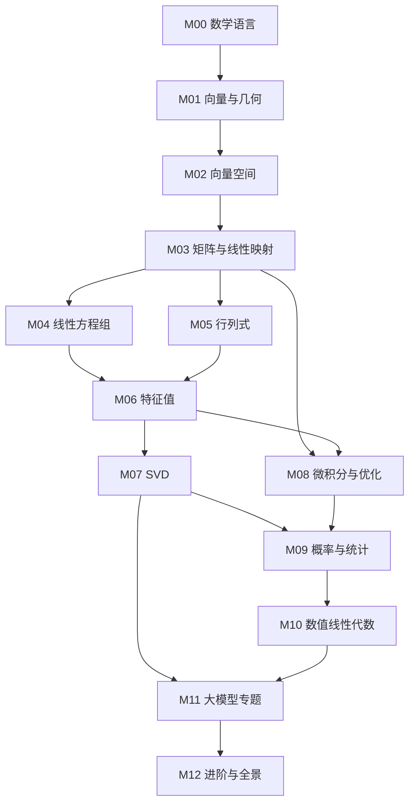

# 学习地图：概念如何长成一张网

> 这不是目录，而是**依赖关系图**与**学习策略**。读某个概念卡住时，回到这里看它依赖谁。

## 0. 先建立现实感

如果读完公式仍觉得空，先看两页：

- [概念—现实对应表](概念-现实对应表.md)：81 个概念各自对应现实中的什么、量级多大、类比在哪里失效。
- [叙事增强规范](叙事增强规范.md)：本课程为什么要在定义之外写「现场、反事实、成本与失败」。
- [图示规划](图示规划.md)：哪些概念值得画图、每张图要回答什么判断、如何新增一张图。

然后回到每一篇的 §0（具体现场）与 §5（手算 + 场景闭环）。公式可以慢一点，但先要知道它在哪个真实问题上出现过。

## 1. 三条主线

线性代数看起来概念很多，其实只有三条主线。把每个新概念挂到某条线上，就不会迷路。

### 主线 A：表示（怎么用数字描述世界）
`向量 → 基/坐标 → 张量 → 嵌入`
- 核心问题：一个对象（箭头、图像、词、一句话）如何变成一串数？
- 关键洞察：**表示不是唯一的**，换一组基就是换一种描述方式。
- 大模型：token → embedding → 隐藏状态，全程都是在选表示。

### 主线 B：变换（对表示做什么）
`矩阵 → 线性映射 → 乘法 → 逆 → 特征值`
- 核心问题：一次线性变换对空间做了什么？能否拆解、撤销、简化？
- 关键洞察：矩阵不是「数字表格」，而是**函数**；乘法是函数的复合。
- 大模型：每一个线性层、每一次 attention 投影，都是这条线上的操作。

### 主线 C：分解（把复杂变简单）
`行列式 → 特征分解 → 对角化 → SVD → 低秩近似`
- 核心问题：一个复杂矩阵能否拆成几个简单矩阵的乘积？
- 关键洞察：分解的目的通常是**理解结构**或**降低计算/存储**。
- 大模型：LoRA 的低秩分解、量化的误差分析、PCA 降维。

三条线在 M11 汇合：一次 Transformer forward = 表示（A）+ 变换（B）+ 分解（C）。

---

## 2. 模块依赖图

**最小可读子图（只想读懂 attention）**：
`0.3 → 1.3 → 1.4 → 1.6 → 3.2 → 3.3 → 3.6 → 7.1 → 11.3 → 11.4`

---

## 3. 概念之间的「对偶」

很多概念成对出现。理解一对，等于理解两篇：

| 一对概念 | 关系 |
|---|---|
| 向量 ↔ 线性泛函 | 一个量方向，一个量「投影到某方向」 |
| 列空间 ↔ 零空间 | 输出的可能范围 ↔ 被压成零的输入 |
| 行空间 ↔ 左零空间 | 同上，从输入侧看 |
| 特征值 ↔ 奇异值 | 方阵「不转向」↔ 任意矩阵「拉伸」 |
| 基 ↔ 坐标 | 参照系 ↔ 参照系下的地址 |
| 范数 ↔ 内积 | 长度 ↔ 角度（内积诱导范数） |
| 逆 ↔ 伪逆 | 精确撤销 ↔ 最优近似撤销 |
| 秩 ↔ 维数 | 矩阵的「有效维度」↔ 空间的维度 |

> 学习技巧：每学完一对，合上书写出「它们分别在问什么问题」。

---

## 4. 三种学习路线

### 路线 A：四周速成（工程优先）
| 周 | 内容 | 目标 |
|---|---|---|
| 1 | M00 + M01 | 能解释 embedding 与余弦相似度 |
| 2 | M02（2.1–2.6）+ M03 | 能看懂线性层与形状推导 |
| 3 | M07（7.1–7.3）+ M11.3–11.4 | 能徒手推导 attention 形状 |
| 4 | M11.7–11.9 + 复习 | 能读懂 KV Cache / LoRA / 量化代码 |

### 路线 B：十周完整（推荐）
| 周 | 内容 | 周目标 |
|---|---|---|
| 1 | M00 + M01 | 建立几何直觉，完成 lab01 |
| 2 | M02 | 掌握基、维数、秩、正交化 |
| 3 | M03 | 矩阵四视角 + 四个子空间 |
| 4 | M04 + M05 | 方程组、最小二乘、行列式 |
| 5 | M06 | 特征值、对角化、二次型 |
| 6 | M07 | SVD、低秩、伪逆 |
| 7 | M08 | 梯度、Jacobian、反向传播 |
| 8 | M09 + M10 | 协方差/PCA、数值稳定性 |
| 9 | M11 | 大模型端到端串讲 |
| 10 | M12 + 总复习 | 全景图 + 自测 |

### 路线 C：研究者加餐
路线 B + 精读：6.4、7.3、8.3–8.5、9.3、10.2、11.3–11.8、12.2。
额外任务：用 NumPy 从零实现单头 attention，并用 SVD 分析一个随机权重矩阵的谱。

---

## 5. 每篇怎么读（20–40 分钟）

1. **先看场景**（2 分钟）：不要急着看定义，先想「如果是我会怎么解决」。
2. **读直觉 + 定义**（8 分钟）：在纸上画图；把定义中的每个符号念出来。
3. **遮住推导自己推**（8 分钟）：尤其是 2×2 的例子。
4. **做练习**（10 分钟）：至少做完计算题，再对答案。
5. **写三行笔记**（2 分钟）：一句话直觉、一个公式、一个大模型落点。

> 如果一篇超过 40 分钟还没懂：不是你的问题，是前置缺了。回到「概念网络」补前置。

---

## 6. 复习节奏

- **当天**：读完立刻做练习（主动回忆）。
- **第 3 天**：只看「一页速记」，尝试复述定义。
- **第 7 天**：做一遍模块自测；把错题记到错题本。
- **第 30 天**：用 `cheatsheets/公式速查.md` 做一次全局串讲。

> 判断「学会了」的标准：能不看书画出概念图，并给一个**没学过的人**讲明白。

---

## 7. 常见学习陷阱

| 陷阱 | 表现 | 解药 |
|---|---|---|
| 把矩阵当表格 | 只会按元素计算，不知道几何意义 | 永远问「这个矩阵对空间做了什么」 |
| 跳过例子 | 看懂了推导，但算不出来 | 每个手算例子自己算一遍 |
| 追求证明完备 | 卡在定理证明里，进度停滞 | 第一遍只要求「能复述结论 + 会用」 |
| 只读不写 | 感觉都懂，一考就忘 | 三行笔记 + 主动回忆 |
| 脱离应用 | 不知道学它干嘛 | 先读每篇的「通往大模型」 |
| 一次学太多 | 贪多嚼不烂 | 一天 1–2 篇，保持节奏 |
